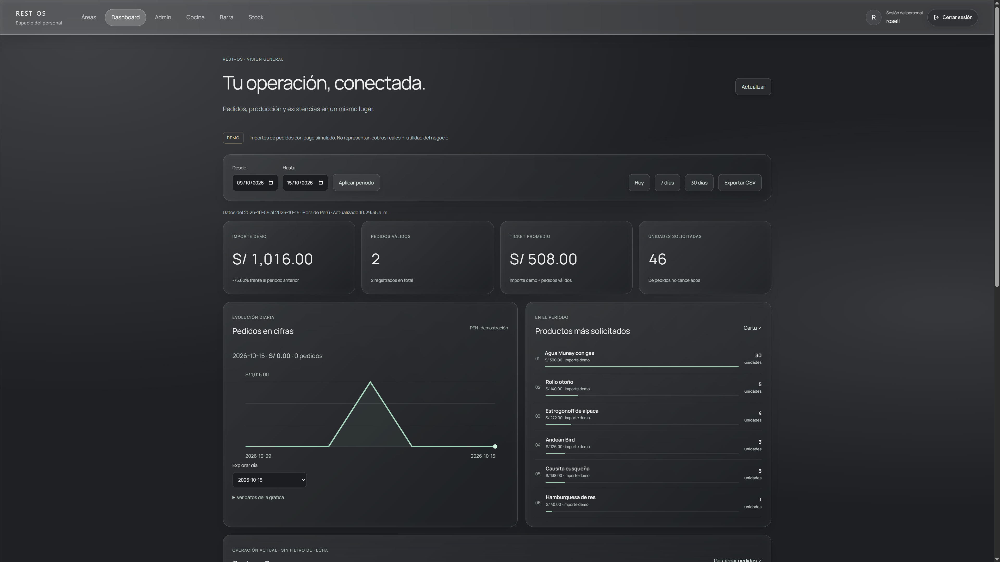

## Una plataforma para la operación del restaurante

RestaurantOS reúne en una aplicación los flujos del cliente y del equipo del restaurante. El cliente explora la carta, consulta detalles de los productos, arma su pedido y puede seguir su preparación. El personal recibe y gestiona el trabajo desde las áreas de Cocina y Barra.

## Experiencia de cliente y asistente RAG

La carta digital permite descubrir productos y consultar información disponible sobre ingredientes y alérgenos. Un asistente basado en recuperación aumentada (RAG) responde preguntas usando documentos de conocimiento asociados a la carta y muestra las fuentes de sus respuestas.

La demo está en fase experimental: los pagos son simulados y parte de la información de productos, alérgenos y políticas es de demostración. No representa una operación comercial real.
## Integración MCP con ChatGPT / OpenAI

El servidor MCP permite que ChatGPT consulte RestaurantOS mediante cinco herramientas de solo lectura:

- **Carta pública:** `listar_productos`, `obtener_producto` y `consultar_disponibilidad`.
- **Analítica privada:** `consultar_dashboard` y `resumen_ventas`, protegidas con OAuth y permisos de personal.

Las consultas privadas requieren una cuenta autorizada de RestaurantOS. El servidor limita las peticiones a endpoints definidos y no permite modificar datos ni ejecutar consultas SQL arbitrarias. Los indicadores de ventas disponibles en la demo son simulados.

## Herramientas para el equipo

- **Producción:** tickets organizados por estación, para Cocina y Barra.
- **Inventario y stock:** turnos, ingresos, mermas, ajustes y conciliación.
- **Costeo:** insumos, recetas versionadas, fichas técnicas y cálculo teórico del costo por porción y margen.
- **Dashboard:** indicadores de pedidos, producción y existencias con filtros por período.

## Decisiones técnicas

- **Backend:** reglas de negocio y operaciones transaccionales con Django REST Framework.
- **Datos:** PostgreSQL y precios históricos para conservar el importe de cada pedido.
- **Operaciones seguras:** reservas de stock y claves idempotentes para evitar duplicados al recuperar intentos.
- **Acceso del personal:** sesiones de Django y permisos separados por rol y estación.
- **Frontend:** React y TypeScript, con caché de catálogo y actualización de disponibilidad.
- **RAG:** búsqueda de documentos de la carta con OpenAI para recuperar contexto relevante antes de responder.
- **MCP:** herramientas para que ChatGPT consulte menú, disponibilidad y analítica privada con OAuth y permisos de solo lectura.

## Costeo de recetas

El cuaderno reúne referencias de insumos, inventario de laboratorio y recetas versionadas. Permite consultar costos teóricos por porción y conservar versiones anteriores para comparar cambios.

## Vista de la operación

El dashboard integra pedidos, actividad diaria y productos solicitados. Los importes y cantidades visibles en esta captura son datos de demostración; no representan ventas ni cobros reales.

## Estado y demo

RestaurantOS es un MVP experimental con una demo navegable en línea. El pago no procesa dinero real y los datos de prueba no deben interpretarse como métricas comerciales. La información sobre ingredientes, alérgenos y políticas también es demostrativa y requiere validación antes de un uso comercial.

[Probar RestaurantOS](https://mvp-rest.vercel.app/menu)
